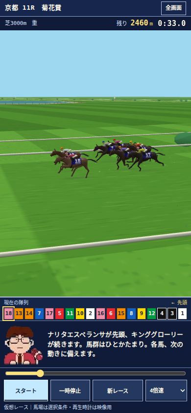

# レトロ・レースUI — 2026-10-23

## 隊列が隠れた原因

隊列が3Dキャンバス内の `bottom:96px` に固定されていた一方、実況欄は後から `16vh` に拡大されていた。390×844の実画面では隊列y=436〜482に対し実況y=443〜578となり、番号列が実況に覆われた。ノード数だけを検査する従来のテストでは発見できなかった。

## 構造

| 領域 | 表示方法 | 意図 |
|---|---|---|
| レース名・全画面 | 上端の独立行 | 長いレース名でも隣の行を覆わない |
| 馬場・残距離・時計 | 独立行 | 3Dの上に重複HUDを載せない |
| 3D／SVG | 可変高の映像領域 | 描画とカメラは既存の共通エンジン |
| 全頭の隊列 | 通常フローの独立行 | 左が先頭。18頭を横スクロールなしで表示 |
| 実況・人物 | 通常フローの独立行 | 人物はユーザー指定の透明WebPを維持 |
| 着順 | 3頭目の通過後のみ実況欄内 | 全馬名を3行で表示。映像の高さを変えず、カメラの再ズームを防ぐ |
| 再生位置・4操作 | 独立行 | スタート・一時停止・新レース・速度／即ゴール |

横画面では実況を映像の横に置き、隊列は両方の下へ置く。通常・全画面とも同じレイアウト制約を使用する。設定・予想・全頭分析はレースの下のナビゲーションから開く。

FC競馬ゲームを思わせる限定的な配色・角のある枠・簡潔な文字組みを採用したオリジナルUIであり、市販ゲームの画面やロゴ・ROM素材は使用していない。3Dをドット絵へ置き換える変更ではない。

## 計算との分離

`assets/race-hud.js` は `drawLive` が持つ現在時刻・進行度・実隊列・ゴール通過順を読むだけ。得点、乱数、馬群の走路、抽選着順を変更しない。WebGLとSVG代替表示が同じHUDを使う。`assets/race-cinematics.js` から表示だけを抽出し、カメラのシーク判定・固定角度追走・走り抜けは維持した。

旧 `premium-mobile.css` は読込を終了し、表示スキンは `race-cinematics.css` に統一。実況を拡大しても隊列を覆えないDOM構造へ変更した。

## 読みやすさ

詳細設定・配点行・説明・倍率・選択肢は、明るい面と濃紺の文字へ統一。通常文字の検証閾値は [W3C WCAGの4.5:1](https://www.w3.org/WAI/WCAG21/Understanding/contrast-minimum.html)。実ブラウザで58要素を背景の透過合成まで含めて測定し、最低約7.09:1。JRA枠色と番号色は既存の共通定義を維持する。

## 回帰防止

- `smoke.mjs`：表示スキン1枚、HUD読取専用、キャッシュ参照、既存の数理・5カメラ契約。
- `race-ui-assertions.mjs`：全番号の矩形・最前面ヒットテスト・クリップ・実況との非交差・実隊列との一致・操作の表示・文字コントラスト。
- `mobile-browser.mjs`／`kikka-browser.mjs`：実WebGLと新UIを同時に検証。馬群と3D位置の一致、視点、連続したゴール通過、即ゴールの同一着順を保持。
- `retro-ui-browser.mjs`：320×568、390×660、430×932、844×390、1280×800、6頭サンプル。WebGL不使用時もHUDが機能し、全画面・実況136pxへの拡大でも隊列が隠れない。結果表示前後の映像高が不変で、3頭の馬名が省略されないことも検査。

スクリーンショットは単なるモックではなく、固定seedの実行画面を使用する。

